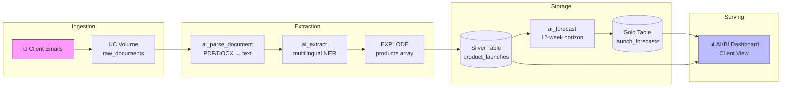
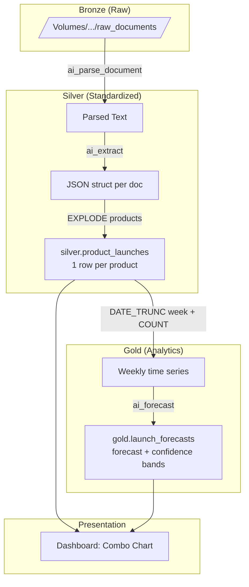

# Product Launch Forecast

End-to-end Databricks solution that ingests semi-structured product launch documents from clients, extracts standardized data using AI, and generates forecasts.

## Architecture



### Data Flow Detail



## Pipeline Stages

| Stage | Notebook | Description |
| --- | --- | --- |
| Setup | `src/setup_catalog.sql` | Creates dedicated catalog, schemas, volumes, tables |
| Extraction | `src/extraction/extract_product_data.sql` | Parses any document format, extracts product fields |
| Forecasting | `src/forecasting/run_forecast.sql` | Generates 12-week forecasts per client |

## Deployment

### Prerequisites

1. Databricks CLI installed (`databricks --version`)
2. Workspace authentication configured
3. SQL warehouse with AI functions enabled

### Deploy to Development

```bash
databricks bundle deploy --target dev
```

### Deploy to Production

```bash
databricks bundle deploy --target prod
```

### Deploy to a New Workspace

1. Add a new target in `databricks.yml`
2. Set variables (catalog, warehouse_id)
3. Run: `databricks bundle deploy --target new_workspace`

## Usage

1. Drop client documents (PDF, DOCX, etc.) into the `raw_documents` volume
2. The daily job (8 AM) picks them up automatically
3. Or trigger manually: `databricks bundle run product_launch_forecast_job`
4. View forecasts in the gold table or connected dashboard
