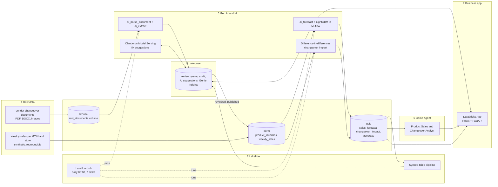

# Product Launch Forecast

End-to-end Databricks solution for retail product changeovers. Vendors send product launch and GTIN changeover documents (PDF, DOCX, images); AI extracts the products, business users review and publish them in a Databricks App, and the platform forecasts weekly unit sales per product, measures how sales changed after each GTIN changeover (formula or packaging change), and lets subject-matter experts question all of it in plain language with Genie.

**Estimated value: about €0.7M a year** for a mid-size grocery or drugstore retailer handling 4,000 vendor changeovers a year. This is an illustrative estimate from stated assumptions, not a measured result; see [Business value](#business-value-estimated).

> **Demo data:** sales history (`silver.weekly_sales`) and most launch history are **synthetic**, generated by `src/synthetic/generate_synthetic_sales` and the seeding steps described below. Only products published from the sample documents are real extractions.

## Data flow

Raw data → **Lakeflow** → **Unity Catalog** → **Lakebase** → made intelligent with **Gen AI and ML** → queryable through a **Genie Agent** → surfaced in a **business app**.



| Stage | What happens | Databricks components | Where in the repo |
| --- | --- | --- | --- |
| 1 Raw data | Vendors send launch and GTIN changeover documents (uploaded in the app or dropped in a volume). Sales history is synthetic but reproducible, with planted changeover effects so results can be checked. | UC Volume | `src/synthetic/generate_synthetic_sales`, sample documents in `bronze.sample_documents` |
| 2 Lakeflow | One Lakeflow Job orchestrates setup, extraction, both forecasts and the Lakebase sync, daily or from the app's Run forecast button. A managed synced-table pipeline copies gold data into Lakebase. | Lakeflow Jobs, synced table pipeline, SQL warehouse, serverless | `resources/forecast_job.yml` |
| 3 Unity Catalog | Bronze (raw files), silver (standardised products, sales), gold (forecasts, impact, accuracy). Governs every read, including the app and Genie, through grants to the app service principal. | Unity Catalog, Delta | `src/setup_catalog.sql`, `src/**` |
| 4 Lakebase | Low-latency operational state for many concurrent reviewers: review queue with version checks, audit log, AI suggestions, forecast runs, cached Genie insights. | Lakebase Postgres, synced tables | `app/backend/db.py`, `resources/app.yml` |
| 5 Gen AI and ML | Gen AI turns documents into structured products and proposes fixes; ML forecasts weekly sales; statistics measure each changeover's effect against unchanged controls. | AI Functions, Model Serving, MLflow | `src/extraction`, `app/backend/suggestions.py`, `src/forecasting`, `src/analysis` |
| 6 Genie Agent | Business users ask in plain language; Genie writes and runs SQL on the governed gold tables and shows the query. The app pre-generates an analysis per product and changeover. | Genie | Genie space (ID in `genie_space_id`), `app/backend/insights.py` |
| 7 Business app | One place for subject-matter experts: upload and review, sales forecast, changeover impact, Genie insights. | Databricks Apps | `app/`, see [`app/SPEC.md`](app/SPEC.md) |

The app's **Architecture** view shows the same flow with the live component names and links of the running deployment.

## What's in the repo

| Area | Path | What it does |
| --- | --- | --- |
| Setup | `src/setup_catalog.sql` | Catalog, bronze/silver/gold schemas, `raw_documents` volume, base tables |
| Extraction | `src/extraction/extract_product_data.sql` | `ai_parse_document` + `ai_extract` on new files in the volume, MERGE into `silver.product_launches` (skips `uploads/`, handled by the app) |
| Sales forecast (SQL) | `src/forecasting/run_sales_forecast` | Builds `gold.product_weekly_sales`; `ai_forecast` of weekly units per product, 12 weeks; holdout accuracy |
| Sales forecast (ML) | `src/forecasting/run_sales_forecast_mlflow` | Global LightGBM model tracked in MLflow; holdout accuracy; `gold.sales_forecast` view of both models |
| Launch-count forecast | `src/forecasting/run_forecast.sql`, `run_forecast_mlflow` | Weekly number of launches per vendor (earlier forecast target; still in the job, not shown in the app) |
| Forecast research | `src/forecasting/forecast_exploration` | Backtest of forecast methods (ai_forecast variants, baselines, LightGBM) |
| Changeover impact | `src/analysis/changeover_impact` | Effect of each GTIN changeover on weekly unit sales (difference-in-differences vs same-category controls, placebo 95% ranges) |
| Synthetic data | `src/synthetic/generate_synthetic_sales` | Reproducible weekly sales per GTIN and store, past changeovers with planted effects, answer key |
| App | `app/` | React + FastAPI Databricks App, see [`app/SPEC.md`](app/SPEC.md) |
| Bundle | `databricks.yml`, `resources/*.yml` | Job, app (with its resources), Lakebase project, synced table |

## Job: `product_launch_forecast_job`

Runs daily at 08:00 (Europe/Madrid). Notebook tasks on the SQL warehouse unless noted.

| Task | Depends on | Output |
| --- | --- | --- |
| `setup_catalog` | | catalog objects |
| `extract_product_data` | `setup_catalog` | `silver.product_launches` |
| `run_sales_forecast` | `extract_product_data` | `gold.product_weekly_sales`, `gold.sales_forecast_ai`, `gold.sales_forecast_accuracy` |
| `sales_forecast_mlflow` (serverless) | `run_sales_forecast` | `gold.sales_forecast_mlflow`, `gold.sales_forecast` view, MLflow run and model |
| `run_forecast` | `extract_product_data` | `gold.launch_forecasts` (launch counts) |
| `forecast_mlflow` (serverless) | `extract_product_data` | `gold.launch_forecasts_mlflow` |
| `sync_forecast_to_lakebase` (pipeline) | `run_forecast` | Lakebase synced copy of `gold.launch_forecasts` |

The app's **Run forecast** button runs only `run_sales_forecast` and `sales_forecast_mlflow`. `changeover_impact` and `generate_synthetic_sales` are run by hand.

## Key tables

| Table | Grain | Notes |
| --- | --- | --- |
| `silver.product_launches` | one row per product in a document | old/new identifier, launch (changeover) date, vendor |
| `silver.weekly_sales` | week × store × GTIN | **synthetic** units, revenue, promo flag |
| `gold.product_weekly_sales` (view) | week × product | old + new GTIN combined; `product_key` = original GTIN |
| `gold.sales_forecast` (view) | model × product × week | next 12 weeks, 90% range; models `mlflow_lightgbm`, `ai_forecast` |
| `gold.sales_forecast_accuracy` | model | last-12-weeks holdout: WAPE, MAE, coverage, bias |
| `gold.changeover_impact` | changeover | effect %, 95% range, significant, controls_fit, status (measured / pending) |
| `gold.changeover_weekly` | changeover × week | actual vs expected units around the switch |

On the current synthetic data, the LightGBM model has a 7.2% holdout WAPE vs 26.9% for `ai_forecast`, and the changeover analysis recovers the planted effects within 1.8 points on average.

## Decisions and trade-offs

| Decision | Chosen | Instead of | Why | Trade-off we accept |
| --- | --- | --- | --- | --- |
| Document extraction | `ai_parse_document` + `ai_extract` in SQL | A custom OCR + LLM pipeline | Runs on the governed SQL warehouse, handles PDF, DOCX and images in many languages, no model or infrastructure to maintain | Less control over prompts and models; the parser occasionally rewrites a code (seen once with a 12-digit GTIN), which is why every value is checked against the document and reviewed by a person |
| Data quality | Human-in-the-loop review before publishing | Writing extracted rows straight to silver | Master-data errors are expensive downstream (wrong GTIN = failed scans and reorders); validation plus a reviewer catches what AI misses | A manual step per document; mitigated by validation, AI fix suggestions and bulk approve |
| App state | Lakebase for the review queue and caches | Editing Delta tables through the warehouse | Millisecond reads and row-level, version-checked edits for many concurrent reviewers; no warehouse start-up for every click | A second store to operate; published data still lands in Delta, which stays the system of record |
| Forecasting | Two models side by side: `ai_forecast` and a global LightGBM in MLflow | A single model | `ai_forecast` is zero-maintenance SQL; LightGBM is far more accurate on this data (7.2% vs 26.9% WAPE). Showing both, with holdout accuracy, builds trust and lets the business choose | Two jobs to run and explain; the MLflow model is retrained each run but not yet registered in Unity Catalog or served |
| Model type | One global LightGBM across products, lags ≥ the 12-week horizon | One ARIMA / Prophet per product | Learns shared seasonality across short histories, one model to maintain, no leakage by construction | Less interpretable per product; promotions aren't used as a feature because future promotions aren't known |
| Measuring a changeover's effect | Difference-in-differences against same-category products, placebo-based 95% ranges, a pre-trend check | Comparing sales before and after the switch | Before/after is badly biased by seasonality (sun care showed +143% raw vs +15% planted). Controls and placebos give an honest effect and range | Needs comparable unchanged products and 15 weeks after the switch, so recent changeovers stay "pending" |
| Natural-language questions | A Genie Agent over curated gold tables | A custom RAG or text-to-SQL agent | Governed by Unity Catalog, shows the SQL it ran, instructions and example SQL are curated in one place | Answers are limited to the tables in the space; quality depends on table descriptions and instructions |
| Genie identity | Genie runs as the app service principal | On behalf of each signed-in user | Simple, predictable permissions for a demo; the SP can only read what it's granted | No per-user row-level security; out of scope for this version |
| Genie insights | Pre-generated per product and changeover, cached with the data version | Asking Genie only when a user clicks | No waiting in a live demo; users see what Genie can do before typing | About 58 Genie questions after each forecast run, prepared one at a time in the background |
| Data | Synthetic sales with planted effects | Public retail datasets | Public datasets don't contain GTIN changeovers with known effects; planted effects let us prove the analysis recovers the truth | Results show the method works, not real-world effect sizes |
| Orchestration and deployment | Lakeflow Job with notebook tasks, everything in a Declarative Automation Bundle | Lakeflow Declarative Pipelines for the transformations | Fast iteration on notebooks and AI functions; one bundle deploys job, app, Lakebase project and synced table | No pipeline expectations or automatic incremental processing; a natural next step for production |

## Business value (estimated)

**Base case: about €690K a year** in gross margin and cost, for a mid-size grocery or drugstore retailer receiving 4,000 product launches and GTIN changeovers a year. These figures are **illustrative estimates from the assumptions below, not measured results**. Replace them with a client's own numbers.

| Value lever | How the solution creates it | Formula | Base estimate per year |
| --- | --- | --- | --- |
| Less master-data effort | AI extraction and review replace manual keying and checking | 4,000 products × 9 min saved × €45/h | **€27K** (600 hours) |
| Fewer costly data errors | Check-digit, date, duplicate and document checks catch wrong GTINs and dates before they reach the shelf | 4,000 × 3% error rate × 70% prevented × €4,000 weekly sales × 2 weeks lost × 30% margin | **€202K** |
| Lower safety stock | A more accurate forecast needs less buffer stock | €60M sales in scope ÷ 52 × 1.5 weeks of safety stock × 40% lower forecast error × 25% carrying cost | **€173K** |
| Better changeover decisions | Measured effects show which formula or packaging changes hurt sales, so teams can act early | 4,000 × 15% with a drop × 8% average drop × €200K annual sales × 10% recovered × 30% margin | **€288K** |
| **Total** | | | **≈ €690K** |

Key assumptions and how sensitive the total is:

* **Forecast error:** a 40% lower forecast error than the retailer's current planning is deliberately conservative. On the synthetic data, LightGBM cut the error by 73% compared with `ai_forecast`.
* **Biggest levers:** data errors and changeover decisions together are about 70% of the total, so the error rate and the share of changeovers that hurt sales matter most.
* **Range:** with all low assumptions (2,000 changeovers, 1% error rate, smaller products) the total is about €50K a year. With all high ones (8,000 changeovers, 5% error rate, larger products) it's about €5.3M. Most real cases will sit between the two.
* **Not counted:** fewer vendor disputes, faster time to shelf, and the time category managers save by asking Genie instead of requesting reports.

## Genie

Genie space **Product Sales & Changeover Analyst** covers `gold.sales_forecast`, `gold.product_weekly_sales`, `gold.sales_forecast_accuracy`, `gold.changeover_impact`, `gold.changeover_weekly` and `silver.product_launches`, with instructions (default model, how product keys link across changeovers, how to read effects), sample questions and example SQL. Its ID is the bundle variable `genie_space_id`; the app uses it as a `genie_space` resource with CAN RUN. The space itself is created in the workspace, not by the bundle.

## Deployment

### Prerequisites

1. Databricks CLI installed (`databricks --version`)
2. Workspace authentication configured
3. SQL warehouse with AI functions enabled (`ai_parse_document`, `ai_extract`, `ai_forecast`)
4. Serverless compute for the MLflow notebook tasks
5. A Genie space over the tables above (set its ID in `genie_space_id`)

### Deploy to Development

```bash
databricks bundle deploy --target dev
```

### Deploy to Production

```bash
databricks bundle deploy --target prod
```

### Deploy to a New Workspace

1. Add a new target in `databricks.yml`
2. Set variables (`catalog`, `warehouse_id`, `genie_space_id`, `lakebase_project_id`)
3. Run: `databricks bundle deploy --target new_workspace`, then `databricks bundle run product_launch_app --target new_workspace`
4. Grant the app service principal SELECT on the gold tables and views it reads (see `app/SPEC.md`, Permissions)

## Usage

Pages are in the left sidebar: **Work** (Upload & review, Ingestion check) and **Insights** (Sales forecast, Changeover impact).

1. Upload vendor documents in **Upload & review**, or drop them into the `raw_documents` volume for the daily job
2. Review the extracted products: the step indicator shows Upload → Review → Publish, the counts filter to errors or pending rows, AI suggests fixes; select rows to approve them, then publish
3. **Sales forecast**: pick a product to see key numbers, the chart for one or both models, and Genie's analysis with suggested questions
4. **Changeover impact**: the measured effect of each GTIN changeover with its 95% range, plus Genie's analysis
5. Ask follow-up questions in plain language in the Genie insights section

### Demo data

* `src/synthetic/generate_synthetic_sales` (re)creates `silver.weekly_sales`, the answer key `silver.synthetic_changeover_truth` and 6 past changeovers in `silver.product_launches`. It is deterministic (fixed `end_week`).
* The synthetic launch history per vendor (`source_file` like `synthetic://seed/<vendor>/...` and the earlier NIVEA history) was inserted directly for the demo; no notebook in the repo recreates it.
* Sample documents for NIVEA, Henkel and Unilever are in `/Volumes/<catalog>/bronze/sample_documents/`.
* Remove synthetic rows with `DELETE FROM <catalog>.silver.product_launches WHERE source_file LIKE 'synthetic://%'` and drop the synthetic tables.
