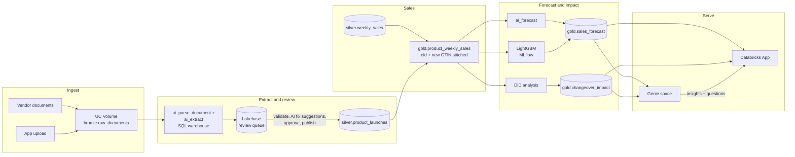

# Product Launch Forecast

End-to-end Databricks solution for retail product changeovers. Vendors send product launch and GTIN changeover documents (PDF, DOCX, images); AI extracts the products, business users review and publish them in a Databricks App, and the platform forecasts weekly unit sales per product, measures how sales changed after each GTIN changeover (formula or packaging change), and lets subject-matter experts question all of it in plain language with Genie.

> **Demo data:** sales history (`silver.weekly_sales`) and most launch history are **synthetic**, generated by `src/synthetic/generate_synthetic_sales` and the seeding steps described below. Only products published from the sample documents are real extractions.

## Architecture



The app also has an **Architecture** button that shows the live components of the running deployment.

## What's in the repo

| Area | Path | What it does |
| --- | --- | --- |
| Setup | `src/setup_catalog.sql` | Catalog, bronze/silver/gold schemas, `raw_documents` volume, base tables |
| Extraction | `src/extraction/extract_product_data.sql` | `ai_parse_document` + `ai_extract` on new files in the volume, MERGE into `silver.product_launches` (skips `uploads/`, handled by the app) |
| Sales forecast (SQL) | `src/forecasting/run_sales_forecast` | Builds `gold.product_weekly_sales`; `ai_forecast` of weekly units per product, 12 weeks; holdout accuracy |
| Sales forecast (ML) | `src/forecasting/run_sales_forecast_mlflow` | Global LightGBM model tracked in MLflow; holdout accuracy; `gold.sales_forecast` view of both models |
| Launch-count forecast | `src/forecasting/run_forecast.sql`, `run_forecast_mlflow` | Weekly number of launches per vendor (earlier forecast target; still in the job, not shown in the app) |
| Forecast research | `src/forecasting/forecast_exploration` | Backtest of forecast methods (ai_forecast variants, baselines, LightGBM) |
| Changeover impact | `src/analysis/changeover_impact` | Effect of each GTIN changeover on weekly unit sales (difference-in-differences vs same-category controls, placebo 95% ranges) |
| Synthetic data | `src/synthetic/generate_synthetic_sales` | Reproducible weekly sales per GTIN and store, past changeovers with planted effects, answer key |
| App | `app/` | React + FastAPI Databricks App, see [`app/SPEC.md`](app/SPEC.md) |
| Bundle | `databricks.yml`, `resources/*.yml` | Job, app (with its resources), Lakebase project, synced table |

## Job: `product_launch_forecast_job`

Runs daily at 08:00 (Europe/Madrid). Notebook tasks on the SQL warehouse unless noted.

| Task | Depends on | Output |
| --- | --- | --- |
| `setup_catalog` | | catalog objects |
| `extract_product_data` | `setup_catalog` | `silver.product_launches` |
| `run_sales_forecast` | `extract_product_data` | `gold.product_weekly_sales`, `gold.sales_forecast_ai`, `gold.sales_forecast_accuracy` |
| `sales_forecast_mlflow` (serverless) | `run_sales_forecast` | `gold.sales_forecast_mlflow`, `gold.sales_forecast` view, MLflow run and model |
| `run_forecast` | `extract_product_data` | `gold.launch_forecasts` (launch counts) |
| `forecast_mlflow` (serverless) | `extract_product_data` | `gold.launch_forecasts_mlflow` |
| `sync_forecast_to_lakebase` (pipeline) | `run_forecast` | Lakebase synced copy of `gold.launch_forecasts` |

The app's **Run forecast** button runs only `run_sales_forecast` and `sales_forecast_mlflow`. `changeover_impact` and `generate_synthetic_sales` are run by hand.

## Key tables

| Table | Grain | Notes |
| --- | --- | --- |
| `silver.product_launches` | one row per product in a document | old/new identifier, launch (changeover) date, vendor |
| `silver.weekly_sales` | week × store × GTIN | **synthetic** units, revenue, promo flag |
| `gold.product_weekly_sales` (view) | week × product | old + new GTIN combined; `product_key` = original GTIN |
| `gold.sales_forecast` (view) | model × product × week | next 12 weeks, 90% range; models `mlflow_lightgbm`, `ai_forecast` |
| `gold.sales_forecast_accuracy` | model | last-12-weeks holdout: WAPE, MAE, coverage, bias |
| `gold.changeover_impact` | changeover | effect %, 95% range, significant, controls_fit, status (measured / pending) |
| `gold.changeover_weekly` | changeover × week | actual vs expected units around the switch |

On the current synthetic data, the LightGBM model has a 7.2% holdout WAPE vs 26.9% for `ai_forecast`, and the changeover analysis recovers the planted effects within 1.8 points on average.

## Genie

Genie space **Product Sales & Changeover Analyst** covers `gold.sales_forecast`, `gold.product_weekly_sales`, `gold.sales_forecast_accuracy`, `gold.changeover_impact`, `gold.changeover_weekly` and `silver.product_launches`, with instructions (default model, how product keys link across changeovers, how to read effects), sample questions and example SQL. Its ID is the bundle variable `genie_space_id`; the app uses it as a `genie_space` resource with CAN RUN. The space itself is created in the workspace, not by the bundle.

## Deployment

### Prerequisites

1. Databricks CLI installed (`databricks --version`)
2. Workspace authentication configured
3. SQL warehouse with AI functions enabled (`ai_parse_document`, `ai_extract`, `ai_forecast`)
4. Serverless compute for the MLflow notebook tasks
5. A Genie space over the tables above (set its ID in `genie_space_id`)

### Deploy to Development

```bash
databricks bundle deploy --target dev
```

### Deploy to Production

```bash
databricks bundle deploy --target prod
```

### Deploy to a New Workspace

1. Add a new target in `databricks.yml`
2. Set variables (`catalog`, `warehouse_id`, `genie_space_id`, `lakebase_project_id`)
3. Run: `databricks bundle deploy --target new_workspace`, then `databricks bundle run product_launch_app --target new_workspace`
4. Grant the app service principal SELECT on the gold tables and views it reads (see `app/SPEC.md`, Permissions)

## Usage

1. Upload vendor documents in the app (**Upload & review**), or drop them into the `raw_documents` volume for the daily job
2. Review the extracted products (validation, AI fix suggestions), approve and publish them
3. **Forecast** tab: weekly unit sales per product from both models, with Genie's analysis and suggested questions below the chart
4. **Changeover impact** tab: the measured effect of each GTIN changeover, with Genie's analysis
5. Ask follow-up questions in plain language in the Genie insights section

### Demo data

* `src/synthetic/generate_synthetic_sales` (re)creates `silver.weekly_sales`, the answer key `silver.synthetic_changeover_truth` and 6 past changeovers in `silver.product_launches`. It is deterministic (fixed `end_week`).
* The synthetic launch history per vendor (`source_file` like `synthetic://seed/<vendor>/...` and the earlier NIVEA history) was inserted directly for the demo; no notebook in the repo recreates it.
* Sample documents for NIVEA, Henkel and Unilever are in `/Volumes/<catalog>/bronze/sample_documents/`.
* Remove synthetic rows with `DELETE FROM <catalog>.silver.product_launches WHERE source_file LIKE 'synthetic://%'` and drop the synthetic tables.
